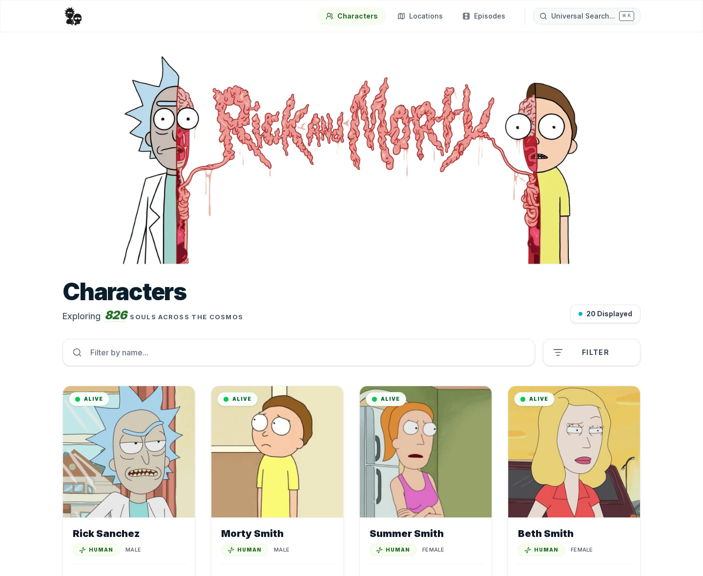

# Rick & Morty Explorer

[](https://github.com/sinahatami/rick-and-morty-web/actions/workflows/ci.yml)
[](https://sinahatami.github.io/rick-and-morty-web)
[](https://opensource.org/licenses/MIT)

**Live demo:** <https://sinahatami.github.io/rick-and-morty-web>



A fast, accessible explorer for the characters, locations and episodes of the Rick and Morty universe,
built on the public [Rick and Morty API](https://rickandmortyapi.com). It is a fully static site: every
character, location and episode page is generated at build time and hosted on GitHub Pages.

## Highlights

- **Real static HTML for every page.** About a thousand detail pages are pre-rendered with their content,
  so they load instantly, work without JavaScript and can be indexed by search engines.
- **Search, filter and share.** Lists load more results on demand; the search text and filters live in the
  URL, so any result can be bookmarked or shared (`/?status=Alive&name=rick`).
- **Universal search** (<kbd>Ctrl</kbd>/<kbd>⌘</kbd> + <kbd>K</kbd>) across characters, locations and
  episodes, downloaded only when it is first opened.
- **Three themes, one design system.** Characters are green, locations blue, episodes orange. The colors are
  CSS variables selected with `data-theme`, so components never pass colors around.
- **Accessible by default.** Semantic landmarks, a skip link, keyboard-friendly cards and dialogs, AA color
  contrast and `prefers-reduced-motion` support. The end-to-end suite runs axe on every page type.
- **Responsive.** A bottom sheet for filters and a slide-out menu on small screens.

## Tech stack

| Area         | Choice                                                                            |
| ------------ | --------------------------------------------------------------------------------- |
| Framework    | Next.js 16 (App Router, static export, Turbopack), React 19                       |
| Language     | TypeScript 6, strict mode                                                         |
| Styling      | Tailwind CSS 4 (CSS-first config), shadcn/ui on Radix UI primitives, lucide icons |
| Data         | TanStack Query 5, a build-time snapshot of the public API                         |
| Unit tests   | Vitest 5, React Testing Library, jsdom                                            |
| End-to-end   | Playwright, axe-core accessibility checks                                         |
| Code quality | ESLint 9 (flat config), Prettier, knip, Husky, lint-staged, commitlint            |
| CI/CD        | GitHub Actions, Lighthouse CI, semantic-release, GitHub Pages                     |
| Tooling      | Node.js 26 (see `.node-version`), pnpm 12 (pinned in `package.json`)              |

## Getting started

You need Node.js 26.13 or newer and [pnpm](https://pnpm.io/installation).

```bash
git clone https://github.com/sinahatami/rick-and-morty-web.git
cd rick-and-morty-web
pnpm install
pnpm dev
```

Open <http://localhost:3000>. The first run downloads a snapshot of the API (about 1,000 records, a few
seconds) into `.cache/api`; later runs reuse it for 24 hours.

### Scripts

| Command                             | What it does                                                           |
| ----------------------------------- | ---------------------------------------------------------------------- |
| `pnpm dev`                          | Development server with Turbopack                                      |
| `pnpm build`                        | Static production build into `out/`                                    |
| `pnpm start`                        | Serves `out/` on port 3000 (Lighthouse tests it; Playwright uses 3100) |
| `pnpm data`                         | Refreshes the API snapshot (`pnpm data -- --force` ignores its age)    |
| `pnpm check`                        | Typecheck, lint, formatting check and unit tests                       |
| `pnpm typecheck` / `pnpm lint`      | TypeScript and ESLint (zero warnings allowed)                          |
| `pnpm format` / `pnpm format:check` | Prettier (also sorts Tailwind classes)                                 |
| `pnpm test` / `pnpm test:watch`     | Unit tests once / in watch mode (`pnpm test:coverage` for coverage)    |
| `pnpm e2e` / `pnpm e2e:ui`          | Playwright tests against `out/` (run `pnpm build` first)               |
| `pnpm knip`                         | Finds unused files, exports and dependencies                           |
| `pnpm lhci`                         | Lighthouse CI against `out/`                                           |
| `pnpm verify`                       | Everything: `check`, `build` and `e2e`                                 |

The first time you run the end-to-end tests, install the browser with `pnpm exec playwright install chromium`.

## How it works

**Static site, no server.** `next build` exports plain files (`output: 'export'`). There is no Node.js process
at runtime, so everything dynamic happens in the browser.

**Build-time data snapshot.** `scripts/fetch-api-data.mjs` downloads all characters, locations and episodes
once (about 50 requests, with retries and rate-limit handling) into `.cache/api`. Pages are generated from that
snapshot, so building a thousand pages costs a handful of API calls and a detail page can show its related
items (the episodes of a character, the residents of a place) without asking the API again.

**Server components for content, client components for interaction.** Detail pages are server components. The
three list pages are server-rendered with their first page of results, then hydrated by TanStack Query, which
fetches further pages, filtered lists and the "load more" batches from the live API in the browser.

**URL as the source of truth.** `useUrlFilters` derives the active filters from the query string and writes
changes back with `history.replaceState`, so typing in the search box does not create history entries or
route changes. Values in the URL are validated against the known option lists.

**Themes with CSS variables.** `ThemeScope` sets `data-theme` from the current section; Tailwind utilities
such as `bg-theme/10` and `text-theme-ink` resolve to that section's colors. A single element can override the
theme (the Citadel of Ricks is rendered green on a blue page).

**Lazy by default.** The search dialog, filter panel, mobile menu, toast library and decorative widgets are
separate chunks that load on first use.

**Rate limits.** The API host refuses a visitor who asks for too much too fast: it answers with HTTP 429 for
about ten seconds, which the browser shows as a broken image or a network error. Clicking "Load more" a few
times is enough to trigger it. `RemoteImage` therefore shows a placeholder instead of a broken avatar and
requests it again after the block (up to three times, with growing pauses), and the query client waits out
the same window between its own retries, so the page recovers without a reload.

### Configuration

| Variable                  | Purpose                                                              | Default                                           |
| ------------------------- | -------------------------------------------------------------------- | ------------------------------------------------- |
| `NEXT_PUBLIC_BASE_PATH`   | Sub-path the site is served from (set by the deploy job)             | none (`/rick-and-morty-web` in production)        |
| `NEXT_PUBLIC_SITE_URL`    | Public URL used for canonical links, Open Graph tags and the sitemap | `https://sinahatami.github.io/rick-and-morty-web` |
| `NEXT_PUBLIC_APP_VERSION` | Version shown in the footer (written by the release job)             | the version in `package.json`                     |

## Project structure

```
src/
├── app/                  Routes (server components), metadata, sitemap, robots, global CSS and theme tokens
├── components/
│   ├── ui/               shadcn/Radix primitives (dialog, select, sheet, popover, command, ...)
│   ├── layout/           Header, footer, page shell, providers, related-items section
│   ├── controls/         Buttons, search box, filter panel, active filter chips
│   ├── data-display/     Cards, badges, stat and detail cards
│   └── feedback/         Empty, error, not-found and "load more" states
├── features/
│   ├── characters/       Components, filter definitions and queries for characters
│   ├── locations/        ... for locations
│   ├── episodes/         ... for episodes
│   └── search/           The universal search dialog
├── hooks/                useUrlFilters, useBatchedByIds, useDebounce, useMediaQuery
├── lib/                  API client and types, build-time dataset, query client, theme, routes, helpers
├── assets/images/        Banners and logo (pre-optimized WebP)
└── test/                 Vitest setup
e2e/                      Playwright specs, API mock and fixtures
scripts/                  API snapshot downloader
```

Each feature folder follows the same shape (`components/`, `filters.ts`, `queries.ts`), so adding a resource
means copying one.

## Testing

- **Unit tests** (`src/**/*.test.ts(x)`) cover the pure logic and hooks: URL filter parsing and syncing, the API
  client, query options, batching, formatting and theme helpers, plus the small shared components.
- **End-to-end tests** (`e2e/`) run against the static build in desktop and mobile Chromium. The public API is
  mocked with small fixtures, so they are fast, deterministic and offline. They cover navigation, search and
  filters, deep links, detail pages (including with JavaScript disabled), the search dialog, rate-limited
  responses, console and hydration errors, and an axe accessibility audit of every page type.
- **Lighthouse CI** audits the production build. Accessibility must be 1.0; performance, best practices and SEO
  have a 0.9 target. Locally, on Lighthouse's throttled mobile profile, accessibility, best practices and SEO
  score 100 and performance is about 0.88.

## Continuous integration and delivery

`.github/workflows/ci.yml` runs on every pull request and every push to `main`:

1. **quality**: typecheck, lint, formatting, knip and unit tests.
2. **e2e**: build, Playwright and Lighthouse CI.
3. **release** (only on `main`, after the two jobs above succeed): [semantic-release](https://semantic-release.org)
   derives the version from the commit messages and updates `CHANGELOG.md`, then the site is built with the
   production base path and published to the `gh-pages` branch.

Git hooks (Husky) run lint-staged, the typecheck and the unit tests before each commit, and commitlint checks
the message. See [CONTRIBUTING.md](CONTRIBUTING.md) for the workflow.

## Credits

Data from [The Rick and Morty API](https://rickandmortyapi.com). Rick and Morty is a trademark of Adult Swim /
Warner Bros. Discovery; this is an unofficial fan project.
